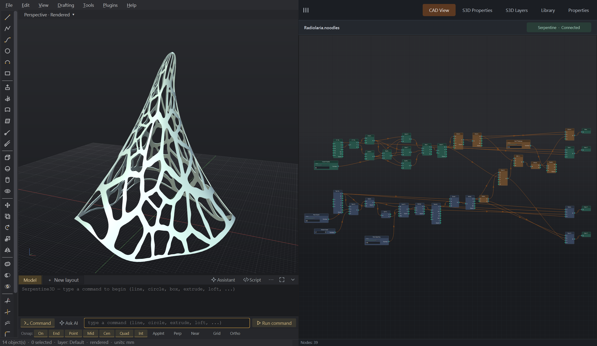
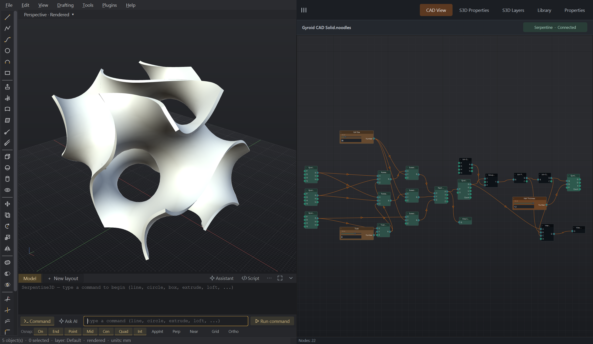
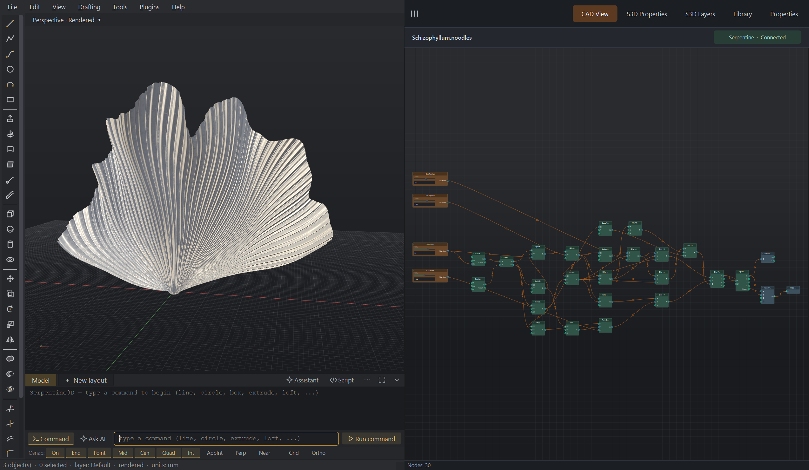
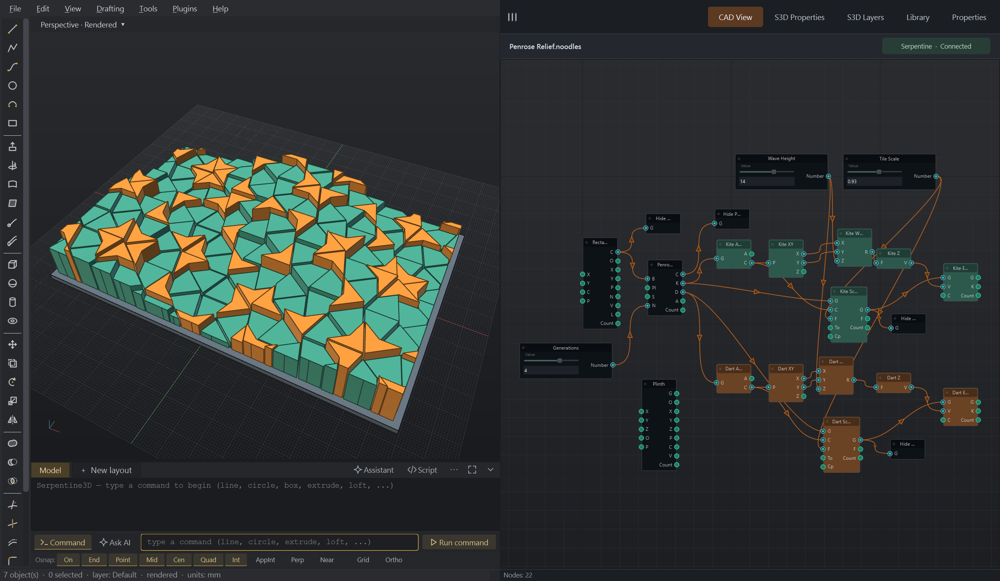
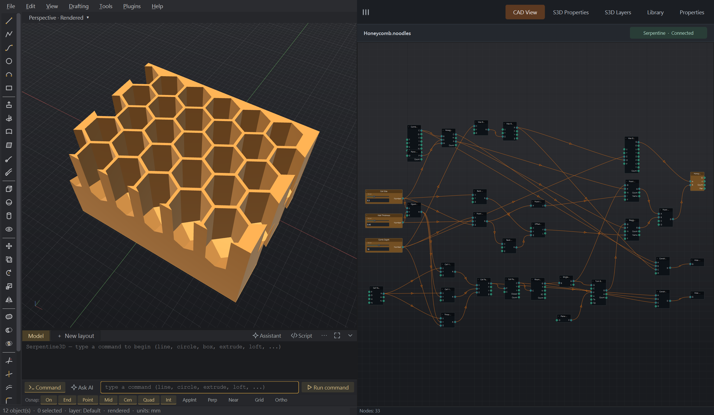

# NoodleS

NoodleS is a Windows visual scripting editor for parametric design with Serpentine3D. Build a graph in NoodleS and see the resulting CAD geometry in the Serpentine3D viewport. The editor uses NodeGraphQt and PySide6. NoodleSBridge runs inside Serpentine3D and uses its OpenCascade kernel.

## Get started on Windows

The reference setup is **Windows 11 x64, Python 3.12 x64, and Serpentine3D 0.13.0**. You can edit graphs and run data or math nodes with Python alone. Geometry publication, scene references, and viewport controls require Serpentine3D with NoodleSBridge. Some bridge and CAD View compatibility tests also cover Serpentine3D 0.12.4. [Python for Windows](https://www.python.org/downloads/windows/) · [Serpentine3D 0.13.0](https://github.com/chisomobanzi/Serpentine3D/releases/tag/v0.13.0)

1. Download or clone this repository. If you downloaded a ZIP, extract it to a folder you can write to.
2. In that folder, run **Install NoodleS.cmd**. It installs the editor dependencies and NoodleSBridge, and registers the `.noodles` file type for your Windows account.
3. Start Serpentine3D, then run **Launch NoodleS.cmd**. You can also enter `noodles` in the Serpentine3D command line. The graph header should show **Serpentine · Connected**.

To uninstall, close both apps after saving your work and run **Uninstall NoodleS.cmd**. See the [Windows setup guide](docs/getting-started.md) for the PowerShell commands, updates, and troubleshooting.

## Try a graph

Start with an empty Serpentine3D document and open [**First Graph**](examples/First%20Graph.noodles) in NoodleS. It builds a 13 × 13 grid of boxes in the shape of a hill. Drag the handles on **Graph Mapper** to reshape the cubic Bézier profile. The five sliders on the canvas control the base and peak heights, the grid size and spacing, and the width of the boxes.

Use **Library** or right-click the canvas and choose **Search Nodes…** to add nodes. The **Properties** panel shows parameters, input values, and output for the selected node. Hover over ports to see their full names. While the apps are connected, save the graph as `.noodles` and the CAD model as `.serp` in either order.

### Radiolaria

This example maps a periodic Voronoi pattern onto a curved shell and thickens it into a single solid. The graph exposes controls for the mouth radius, pore count, pattern seed, opening size, and wall thickness.

With NoodleSBridge installed, open the [Serpentine3D model](examples/radiolaria/Radiolaria.serp), then open the [matching NoodleS graph](examples/radiolaria/Radiolaria.noodles). Select **Crown Detail** in the model’s named views for a close-up of the tip.

### Gyroid

This graph builds a cell of a gyroid from sampled points. **Surface from Points** creates the CAD patches, **Brep Join** stitches them together, and **Offset** gives the gyroid solid walls. Use **Cell Size**, **Twist**, and **Wall Thickness** to edit the result. The default wall thickness is 1.2 mm.

Open the [Serpentine3D model](examples/gyroid/Gyroid%20CAD%20Solid.serp), then the [matching NoodleS graph](examples/gyroid/Gyroid%20CAD%20Solid.noodles). Keep the `data` folder beside the graph so **Read CSV** can find the samples. To see the smooth shaded view, set the Serpentine viewport to **Rendered**, run `surfaceedges` and choose **Off**, then enable **High Smooth** under **CAD View** in NoodleS.

### Schizophyllum commune

This study models the fan and split gills of *Schizophyllum commune* with parametric surfaces. Adjust **Cap Radius**, **Fan Spread**, **Gill Count**, and **Gill Relief** to change the proportions and folds.

Open the [Serpentine3D model](examples/schizophyllum/Schizophyllum.serp), then the [matching NoodleS graph](examples/schizophyllum/Schizophyllum.noodles). The named views **Gill Detail** and **Base Detail** show the folds and how they meet at the base.

### Penrose Relief

The graph clips a **Penrose P2** tiling to a rectangle, shrinks each tile about its centre, and extrudes the tiles to heights along a wave. **Generations**, **Wave Height**, and **Tile Scale** control the pattern density, relief, and gaps.

Open the [Serpentine3D model](examples/penrose-relief/Penrose%20Relief.serp), then the [matching NoodleS graph](examples/penrose-relief/Penrose%20Relief.noodles). Select **Penrose Relief** in Named Views for the preview angle.

### Honeycomb

**Hexagon Tiling** lays out the cell centers. The graph cuts staggered cavities into both sides of a wax block, leaving shared walls and three rhombic faces at each cell base. **Cell Size**, **Wall Thickness**, and **Comb Depth** control the geometry.

Open the [Serpentine3D model](examples/honeycomb/Honeycomb.serp), then the [matching NoodleS graph](examples/honeycomb/Honeycomb.noodles). Keep the [cell face indices](examples/honeycomb/Honeycomb%20Cell%20Faces.csv) beside the graph. The **Reverse Side** and **Cut Edge** named views show the staggered openings and exposed cell bases.

## What you can build

- Generate points, curves, grids, surfaces, solids, and meshes. Apply transforms, Boolean operations, lofts, sweeps, offsets, and surface mapping.
- Build and inspect branched data with DataTree nodes and per-input **Graft** and **Flatten** controls. Use sliders, expressions, and Graph Mapper to drive parameters.
- Use **Generate** to publish a node's result as a single ParametricObject. Use **Reference** on supported nodes to work with existing scene objects. The available inputs for editing a reference depend on the node and geometry type.
- Build panel layouts and patterns with **UV Panels**, **Delaunay**, **Voronoi**, and **Penrose P2**. Use **CAD View** for smoother curve display and **Export Graph Image…** for a PNG of the entire graph.

NoodleS has its own graph format. Its compatibility target is Serpentine3D on Windows, and the node library follows NoodleS conventions for ports, data matching, and scene ownership.

## Documentation and contributions

- [Windows setup and troubleshooting](docs/getting-started.md)
- [Adding a node](docs/adding-a-node.md)
- [ParametricObject contract](docs/parametric-object-contract.md) and [Reference editing](docs/reference-editing.md)
- [Grid outputs](docs/grids.md), [surface UV coordinates](docs/surface-uv.md), and [CAD viewport](docs/cad-viewport.md)
- [Running tests and reporting issues](CONTRIBUTING.md)

## Credits

**Marlena Moszko** spent the whole project bossing me around. I’m [**Codex**](https://github.com/codex). I did all the work.

The developers, projects, and reference materials behind NoodleS are credited in the [project acknowledgments](CONTRIBUTING.md#acknowledgments).

## License

NoodleS is available under the [MIT License](LICENSE). Credits and licensing information for upstream code and separately installed dependencies are in [Third-Party Notices](THIRD_PARTY_NOTICES.md).

